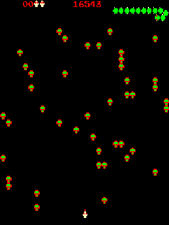
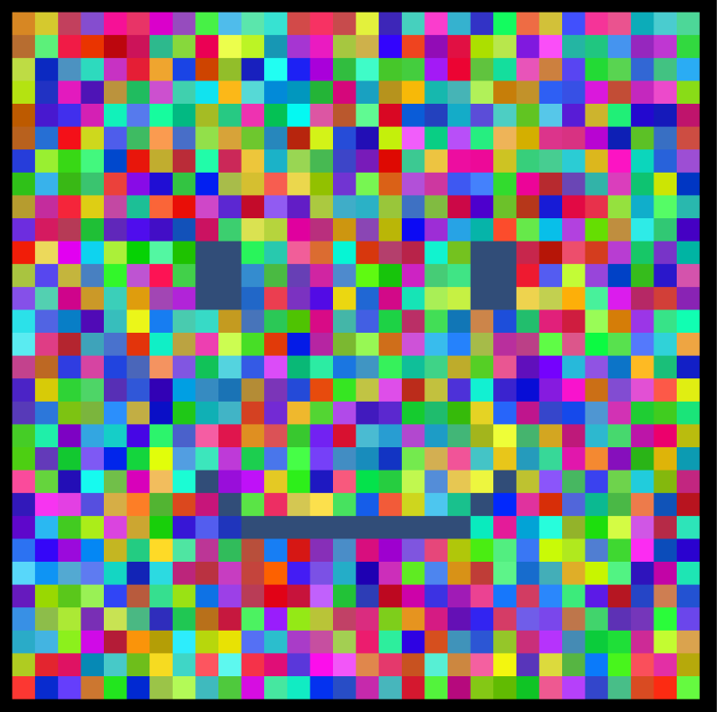
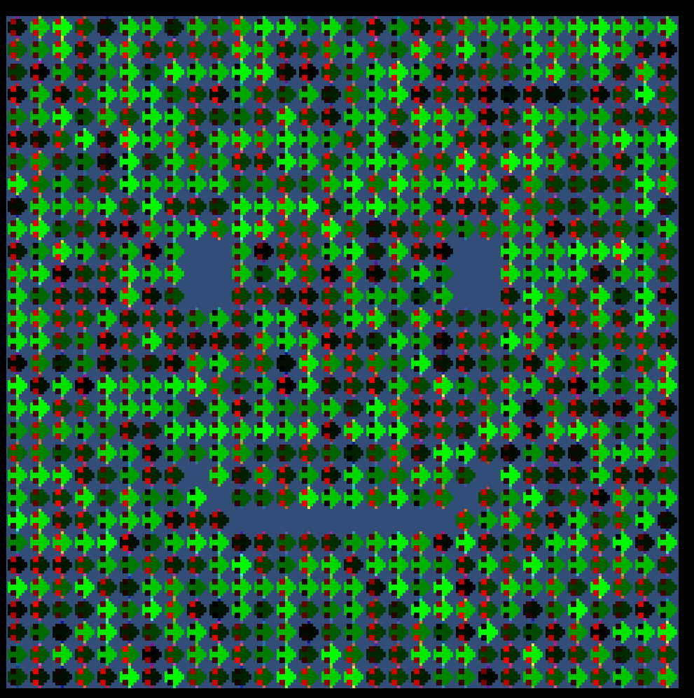
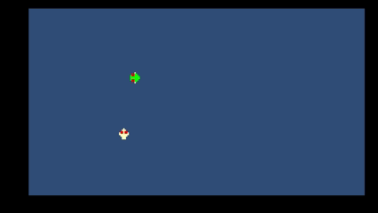
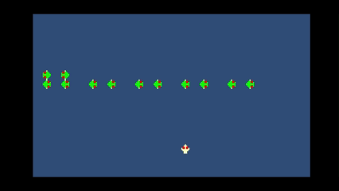
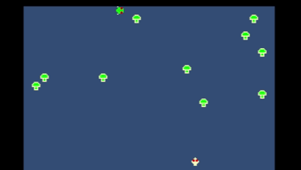
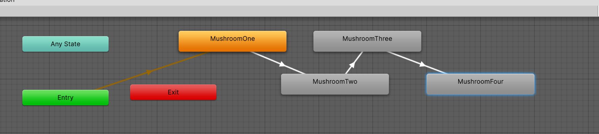
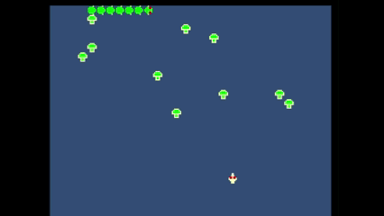
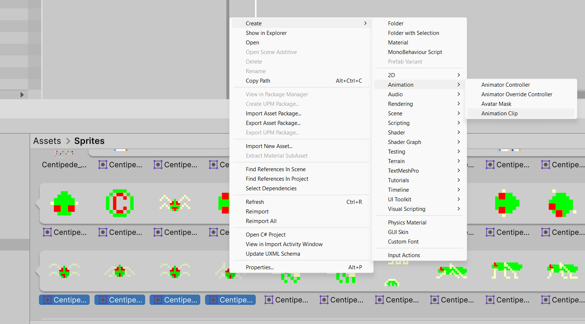

----

[TOC]

----

# Housekeeping

## Notes
- [Reference](https://www.retrogamedeconstructionzone.com/2020/08/the-characters-of-centipede.html)
- from reference link above:



## Unity, quick reminder of QWERTY tools:

| Command | Tool/Mode | Description |
| :--- | :--- | :--- |
| **Q** | Hand | For panning and navigating the Scene view. |
| **W** | Move | For translating (moving) objects along their X, Y, and Z axes. |
| **E** | Rotate | For rotating objects around their local or global axes. |
| **R** | Scale | For uniformly or non-uniformly scaling (stretching/resizing) objects. |
| **T** | Rect Transform | Primarily used for UI elements and 2D objects. |
| **Y** | Transform | A combination of the Move, Rotate, and Scale tools in a single gizmo. |

## Build Notes
- I am using 6000.6.8f1
- Universal Render 2D Pipeline is active
- In my notes, I  refer to panels as:

| &nbsp; Panel Name &nbsp; | &nbsp; Short Form &nbsp; | &nbsp; Description &nbsp; |
| :--- | :--- | :--- |
| &nbsp; Scene | &nbsp; **S** | &nbsp; Where you can drag objects and build 3D scene |
| &nbsp; Hierarchy | &nbsp; **H** | &nbsp;  See objects and their inheritance |
| &nbsp; Inspector | &nbsp; **I** | &nbsp; Detailed information on components for selected object &nbsp;|
| &nbsp; Project | &nbsp; **P** | &nbsp;  See resources relative to file directory |
| &nbsp; Game | &nbsp; **G** | &nbsp; Where the game is played |


# Setup Project

## Create Project
- Organization: whatever you like
- Project Name: Unity\_Centipedes
- no Cloud, no AI, no CLI, no Source Control
- Create Project
- Close annoying popup
- right click A, Welcome; delete it

## Set up git
- YMMV
<pre style="background-color: #505050; color: #ffffff; padding:15px; margin:5px">
PowerShell 7.6.9
PS C:\Users\steve> set-Location C:\Users\steve\unity_projects\Unity_Centipedes\
PS C:\Users\steve\unity_projects\Unity_Centipedes> copy '..\MissileCommand\.gitignore' .
PS C:\Users\steve\unity_projects\Unity_Centipedes> git init
Initialized empty Git repository in C:/Users/steve/unity_projects/Unity_Centipedes/.git/
PS C:\Users\steve\unity_projects\Unity_Asteroids> git add .
...

PS C:\Users\steve\unity_projects\Unity_Centipedes> git commit -m "Initial commit"
...
</pre>

# About the Game
- notes about game play
- 30 x 30 grid
- top row and bottom row are not used for game play
<pre style="background-color: #505050; color: #ffffff; padding:15px; margin:5px">
• Pixels Per Unit (PPU): Set this exactly to 32. This tells Unity that 32 pixels equal 1 World Unit in space. Consequently, each cell in your 30x30 grid will be exactly \(1 \times 1\) unit in Unity's 3D/2D space, making your movement math incredibly clean.
• Filter Mode: Change from Bilinear to Point (no filter). This prevents Unity from trying to smooth out your pixels.
• Compression: Set to None or High Quality to prevent compression artifacts on your pixel art.
</pre>


## Setup : Unity's Pixel Perfect Camera Component
- grab a package
<pre style="background-color: #505050; color: #ffffff; padding:15px; margin:5px">
2D Pixel Perfect  6.0.0 · March 06, 2026 By Unity Technologies
</pre>
- H, Camera
    - add comp: Pixel Perfect Camera
    - Assets Pixels Per Unity: 32
    - Reference Resolution: 960x960
    - Crop Frame: Windowbox
    - Grid Snapping: Upscale Render Texture
    - Position:
        X: 15  Y: 15   Z: -10
- git break "setup Camera"


# Sprite
- rclick H; create empty, name Spacer
- rclick H, Spacer; 2d, Sprites, Square; name Sprite
    - Position: 0.5 0.5 0
- note: you can move the square around the 30x30 matrix
- just change the X: 1, Y: 29 of Spacer
- dupe and test this a few times
- ok, lets make a test grid
- rclick A; create folder; name Prefabs
- drag H, Spacer into A, Prefabs
- rclick A; create folder; name Scripts
- oh, lets pause and make a namespace for our project
- Edit - Project Properties - Editor
    - Root Namespace: Centipede
    - close
- now rclick A, Scripts; create mono; name GameManager
- open GameManager
- 7,17d   (delete Start and Update methods)
- add a spacer prefab
<pre style="background-color: #505050; color: #ffffff; padding:15px; margin:5px">
        [Header("Prefabs")]
        [SerializeField] private GameObject spacer
</pre>
- save, unity
- rclick H; create empty; name GameManager
    - add comp: Game Manager (Script)
    - drag A, Prefabs, Spacer into Spacer on the script
- edit GameManager
- make it a singleton
<pre style="background-color: #505050; color: #ffffff; padding:15px; margin:5px">
        private static GameManager instance;
        public static GameManager Instance { get => instance; private set => instance = value; } 

        private void Awake()
        {
            if (Instance != null && Instance != this)
            {
                Destroy(gameObject);
                return;
            }
            Instance = this;
            DontDestroyOnLoad(gameObject);
        }
</pre>
- to force it to pretend to be created when the scene reloads
<pre style="background-color: #505050; color: #ffffff; padding:15px; margin:5px">
        private void OnEnable()
        {
            SceneManager.sceneLoaded += OnSceneLoaded;
        }

        private void OnDisable()
        {
            SceneManager.sceneLoaded -= OnSceneLoaded;
        }

        private void OnSceneLoaded(Scene scene, LoadSceneMode mode)
        {
            /* add code to reload here */
        }
        
</pre>
- lets add a test to make sure we have corridinates correct
<pre style="background-color: #505050; color: #ffffff; padding:15px; margin:5px">
       private void OnSceneLoaded(Scene scene, LoadSceneMode mode)
       {
           /* add code to reload here */
           DrawTestGrid();
       }
       
       private void DrawTestGrid()
       {
           // code will draw a random pattern, with a smiley face.
           // check shows us that our 30x30 grid is oriented correctly.

           HashSet<Vector2Int> skipList = new HashSet<Vector2Int>();

           // Left Eye (a 2x3 block of empty cells)
           skipList.Add(new Vector2Int(8, 19)); skipList.Add(new Vector2Int(9, 19));
           skipList.Add(new Vector2Int(8, 18)); skipList.Add(new Vector2Int(9, 18));
           skipList.Add(new Vector2Int(8, 17)); skipList.Add(new Vector2Int(9, 17));

           // Right Eye (a 2x3 block of empty cells)
           skipList.Add(new Vector2Int(20, 19)); skipList.Add(new Vector2Int(21, 19));
           skipList.Add(new Vector2Int(20, 18)); skipList.Add(new Vector2Int(21, 18));
           skipList.Add(new Vector2Int(20, 17)); skipList.Add(new Vector2Int(21, 17));

           // The Smile (Bottom flat part)
           for (int x = 10; x <= 19; x++) skipList.Add(new Vector2Int(x, 7));

           // Left smile curve
           skipList.Add(new Vector2Int(9, 8)); skipList.Add(new Vector2Int(8, 9));
           // Right smile curve
           skipList.Add(new Vector2Int(20, 8)); skipList.Add(new Vector2Int(21, 9));

           for (int x = 0; x < 30; x++)
           {
               for (int y = 0; y < 30; y++)
               {
                   // Create our coordinate key
                   Vector2Int currentPos = new Vector2Int(x, y);

                   // Check if this coordinate is part of the smiley face cutout
                   if (skipList.Contains(currentPos))
                   {
                       continue; // Skip
                   }

                   // create spacer prefab
                   GameObject g = Instantiate(spacerPrefab);
                   g.transform.position = new Vector3(x, y, 0);

                   // set color to some random color
                   SpriteRenderer spriteSR = g.GetComponentInChildren<SpriteRenderer>();
                   spriteSR.color = Random.ColorHSV(0f, 1f, 0.6f, 1f, 0.7f, 1f);
               }
           }
       }
</pre>
- gives us
- 
- git break "set up x, y coordinates for drawing sprites"

# Sprite Sheet Import
- try : https://www.spriters-resource.com/arcade/centipede/asset/50437/
- download: ```Arcade - Centipede - Miscellaneous - General Sprites.png```
- try: https://spritedatabase.net/file/10504
- download: ```Centipede```
- we needed to open the spritesheet in Krita:
<pre style="background-color: #505050; color: #ffffff; padding:15px; margin:5px">

 Color to Alpha

1. Select the layer containing your image/black background in the Layers docker.
2. Go to the top menu and select Filter > Colors > Color to Alpha...
3. A dialog box will appear. By default, the target color is white. Click on the Color picker/color box in that window.
4. Change the selected color to Black (Hex code #000000) and click OK.
5. You should see the black areas instantly turn into a checkerboard pattern, representing transparency. Click OK to apply the filter
</pre>
- I saved it as Centipede_Trans.png
- Unity can now look at it and create sprites
    - remember PPU needs to be 8 (its 100 by default)
    - note: its 8x8 images
    - Filter mode should be Point (no filter)
    - Compression should be : None
- as an experiment. lets make a prefab
- dupe A, Prefabs, Spacer; rename CentipedeHead
- dclick A, Prefabs, CentipedeHead
- H, CentipedeHead, Sprite
    - Sprite: Centipede_Trans_9
- go back to scene
- click on Gamemanager
- drag in centipedehead into SpacerPrefab
- and run
- 
- looks ok for now
- git break "import/edit/test spritesheet"

# Animation
- have not done one of these for a bit
- watch a video: https://www.youtube.com/watch?v=AdQz2wStdLY
- take some notes and adapt for our use
- rclick A; create folder; name Animations
- rclick A, Animations; create Animator Controller; name: CentiAnim
- rclick A, Animations; create Animation Clip; name: Idle
- rclick A, Animations; create Animation Clip; name: Run
- A, Animations; select Idle, Run (both);  Loop Time [x]
- click on H, Centipede
    - add comp: Animator
    - drag CentiAnim into Controller
- Window Animation - Animator
    - drag in Idle Animation into Animator window
    - also drag in the Run animation
- H, Centipede
- click the Animation tab
- select idleing sprites from sprite sheet and drag into the animator window
- stretch to make idel realistic
- in the Animation tab, select run
- grab "running" sprites drag into animation tab
- stretch to make ruin realistic
- select Animator tab
    - Parameter +; Bool; name it isRunning
    - rclick Idle box, make transition, click on Run box
    - click ojn the arrow
        - uncheck exit time
        - Condition: +, isRunning : true
        - Transition Duration: 0
    - rclick Run box, make transition, click on Idle box
    - click on the arrow
        - uncheck exit time
        - Condition: +, isRunning : false
        - Transition Duration: 0
- code ???
- [SF] private Animator animator;
- somewhere where "movement" is handled
<pre style="background-color: #505050; color: #ffffff; padding:15px; margin:5px">
if moving:
    animator.SetBool("isRunning", true);
else:
    animator.SetBool("isRunning", false);
- save, unity, assign the animator in the script ???
</pre>

# Grid
- rclick H; create empty; name GridGamaner
- H, GridManager
    - add comp: GridManager (script)
- open GridManager script
- 7,17d
- cut and paste from GameManager
<pre style="background-color: #505050; color: #ffffff; padding:15px; margin:5px">
        [Header("Prefabs")]
        [SerializeField] private GameObject spacerPrefab;
</pre>
- and
<pre style="background-color: #505050; color: #ffffff; padding:15px; margin:5px">
        private void Update()
        {
            // 1. Get raw screen pixel coordinates (0 to 960)
            Vector2 mouseScreenPos = Mouse.current.position.ReadValue();

            // 2. Convert pixels into real World coordinates (e.g., 0.0 to 30.0)
            Vector3 mouseWorldPos = Camera.main.ScreenToWorldPoint(mouseScreenPos);

            // 3. Convert to integers for your 30x30 matrix array lookup
            // Mathf.FloorToInt ensures it maps cleanly to grid cells (e.g., 0, 1, 2... 29)
            int matrixX = Mathf.FloorToInt(mouseWorldPos.x);
            int matrixY = Mathf.FloorToInt(mouseWorldPos.y);

            // 4. Safety check to make sure the mouse is actually inside your 30x30 matrix boundaries
            if (matrixX >= 0 && matrixX < 30 && matrixY >= 0 && matrixY < 30)
            {
                Debug.Log($"Hovering over Matrix Coordinates: [{matrixX}, {29-matrixY}]");

                // Your matrix logic here, for example:
                // myGrid[matrixX, matrixY] = ...
            }
        }
</pre>
- and
<pre style="background-color: #505050; color: #ffffff; padding:15px; margin:5px">
        public void DrawTestGrid()
        {
            HashSet<Vector3> skipList = TestDrawSmileyData();

            for (int x = 0; x < 30; x++)
            {
                for (int y = 0; y < 30; y++)
                {
                    Vector3 currentPos = worldPos(x, y);

                    // Check if this coordinate is part of the smiley face cutout
                    if (skipList.Contains(currentPos)) { continue;  }

                    // create spacer prefab
                    GameObject g = Instantiate(spacerPrefab);
                    g.transform.position = currentPos;

                    // set color to some random color
                    SpriteRenderer spriteSR = g.GetComponentInChildren<SpriteRenderer>();
                    spriteSR.color = Random.ColorHSV(0f, 1f, 0.6f, 1f, 0.7f, 1f);
                }
            }
        }
...
        private HashSet<Vector3> TestDrawSmileyData()
        {
            HashSet<Vector3> skipList = new HashSet<Vector3>();

            // Left Eye (a 2x3 block of empty cells)
            skipList.Add(new Vector3(8, 19, 0)); skipList.Add(new Vector3(9, 19, 0));
            skipList.Add(new Vector3(8, 18, 0)); skipList.Add(new Vector3(9, 18, 0));
            skipList.Add(new Vector3(8, 17, 0)); skipList.Add(new Vector3(9, 17, 0));

            // Right Eye (a 2x3 block of empty cells)
            skipList.Add(new Vector3(20, 19, 0)); skipList.Add(new Vector3(21, 19, 0));
            skipList.Add(new Vector3(20, 18, 0)); skipList.Add(new Vector3(21, 18, 0));
            skipList.Add(new Vector3(20, 17, 0)); skipList.Add(new Vector3(21, 17, 0));

            // The Smile (Bottom flat part)
            for (int x = 10; x <= 19; x++) skipList.Add(new Vector3(x, 7, 0));

            // Left smile curve
            skipList.Add(new Vector3(9, 8, 0)); skipList.Add(new Vector3(8, 9, 0));
            // Right smile curve
            skipList.Add(new Vector3(20, 8, 0)); skipList.Add(new Vector3(21, 9, 0));

            return skipList;
        }

</pre>
- open GameManager
- add:
<pre style="background-color: #505050; color: #ffffff; padding:15px; margin:5px">
        private GridManager gridManager;
</pre>
- and
<pre style="background-color: #505050; color: #ffffff; padding:15px; margin:5px">
       private void OnSceneLoaded(Scene scene, LoadSceneMode mode)
       {
           /* grab game objects we need */
           gridManager = FindAnyObjectByType<GridManager>();

           /* add code to reload here */
           gridManager.DrawTestGrid();
       }
</pre>
- and
<pre style="background-color: #505050; color: #ffffff; padding:15px; margin:5px">
        private Vector3 worldPos(int x, int y)
        {
            // convert grid pos to realworld position
            return new Vector3(x, 29 - y, 0);
        }
</pre>

- save, unity
- H, GridManager
    - Spacer Prefab: Centipede (prefab dragged from A, Prefabs)
- this moves all the logic for grid management into its own class
- which the GameManager can access
- add test for click x,y location
- in GameManager add
<pre style="background-color: #505050; color: #ffffff; padding:15px; margin:5px">
        private void Update()
        {
            gridManager.TestMouseClickXY();
        }
</pre>
- I also renamed DrawTestGrid to TestDrawGrid
- back in GridManager
<pre style="background-color: #505050; color: #ffffff; padding:15px; margin:5px">
        public void TestMouseClickXY()
        {
            if (Mouse.current.leftButton.wasPressedThisFrame)
            {

                Vector2 mouseScreenPos = Mouse.current.position.ReadValue();

                Vector3 mouseWorldPos = Camera.main.ScreenToWorldPoint(mouseScreenPos);
                Vector3 gridPos = GridPos(mouseWorldPos);

                Debug.Log($"Hovering over Matrix Coordinates: [{gridPos.x}, {gridPos.y}]");
            }
        }
</pre>
- git break "work on grid cords, refine Tests"

## pondering the grid
- my smileface test uses worldpos, not gridpos
- which is fine, we convert
- but its a little counterintuitive
<pre style="background-color: #505050; color: #ffffff; padding:15px; margin:5px">
        private HashSet<Vector3> TestDrawSmileyData2()
        {
            HashSet<Vector3> smileCoordinates = new HashSet<Vector3>();

            // === EYES (2x2 Blocks) ===
            // Left Eye
            smileCoordinates.Add(new Vector3(8, 9, 0)); smileCoordinates.Add(new Vector3(9, 9, 0));
            smileCoordinates.Add(new Vector3(8, 10, 0)); smileCoordinates.Add(new Vector3(9, 10, 0));

            // Right Eye
            smileCoordinates.Add(new Vector3(20, 9, 0)); smileCoordinates.Add(new Vector3(21, 9, 0));
            smileCoordinates.Add(new Vector3(20, 10, 0)); smileCoordinates.Add(new Vector3(21, 10, 0));


            // === MOUTH CURVE (Left to Right) ===
            // Left Upturn
            smileCoordinates.Add(new Vector3(5, 15, 0));
            smileCoordinates.Add(new Vector3(6, 16, 0));
            smileCoordinates.Add(new Vector3(7, 17, 0));
            smileCoordinates.Add(new Vector3(8, 18, 0));
            smileCoordinates.Add(new Vector3(9, 19, 0));
            smileCoordinates.Add(new Vector3(10, 20, 0));
            smileCoordinates.Add(new Vector3(11, 21, 0));

            // Bottom Base
            smileCoordinates.Add(new Vector3(12, 22, 0)); smileCoordinates.Add(new Vector3(13, 22, 0));
            smileCoordinates.Add(new Vector3(14, 23, 0)); smileCoordinates.Add(new Vector3(15, 23, 0));
            smileCoordinates.Add(new Vector3(16, 22, 0)); smileCoordinates.Add(new Vector3(17, 22, 0));

            // Right Upturn
            smileCoordinates.Add(new Vector3(18, 21, 0));
            smileCoordinates.Add(new Vector3(19, 20, 0));
            smileCoordinates.Add(new Vector3(20, 19, 0));
            smileCoordinates.Add(new Vector3(21, 18, 0));
            smileCoordinates.Add(new Vector3(22, 17, 0));
            smileCoordinates.Add(new Vector3(23, 16, 0));
            smileCoordinates.Add(new Vector3(24, 15, 0));

            return smileCoordinates;

        }
</pre>
- then mod the 
<pre style="background-color: #505050; color: #ffffff; padding:15px; margin:5px">
        public void TestDrawGrid()
        {
            //HashSet<Vector3> skipList = TestDrawSmileyData();
            HashSet<Vector3> skipList = TestDrawSmileyData2();

            for (int x = 0; x < 30; x++)
            {
                for (int y = 0; y < 30; y++)
                {
                    Vector3 currentPos = WorldPos(x, y);

                    if (skipList.Contains(new Vector3(x,y,0))) { continue; }

 ...
                }
            }
        }
</pre>


# Add player
- usual sort of thing
- rclick H; creaste empty; name Player
- drag  A, Prefabs, Spacer as a child of Player
- (for now)
- add comp: Player (new script)
- open Player script
- remove 7,17d
- open Game Manager script
- add:
<pre style="background-color: #505050; color: #ffffff; padding:15px; margin:5px">
        private Player player;
</pre>
- add to the OnSceneLoaded
<pre style="background-color: #505050; color: #ffffff; padding:15px; margin:5px">
          player = FindAnyObjectByType<Player>();
</pre>
- oh, lets comment out the call to TestDrawGrid
- open Player script
<pre style="background-color: #505050; color: #ffffff; padding:15px; margin:5px">
        public void MovePlayer()
        {

            Vector2 mouseScreenPos = Mouse.current.position.ReadValue();

            Vector3 mouseWorldPos = Camera.main.ScreenToWorldPoint(mouseScreenPos);
            Vector3 gridPos = FindAnyObjectByType<GridManager>().GridPos(mouseWorldPos);
            // bound to lower 12 rows
            if (gridPos.y < 18) gridPos.y = 18;
            if (gridPos.y > 29) gridPos.y = 29;
            if (gridPos.x < 0) gridPos.x = 0;
            if (gridPos.x > 29) gridPos.x = 29;

            gridPos.y = 29 - gridPos.y;
            transform.position = gridPos; 
        }
</pre>
- save, unity , test
- the player will chase the mouse, but be bounded
- next swap the H, Player, Spacer with A, Sprites, Centipede_Trans_68
- position Centipede_Trans_68 0.5 0.5 0
- (probably should rename it to H, Player, Sprite for consistency)
- lets lock/hide the mouse
- in GameManager:
<pre style="background-color: #505050; color: #ffffff; padding:15px; margin:5px">
        void Start()
        {
            //Cursor.lockState = CursorLockMode.Locked;
            Cursor.visible = false;
        }
</pre>
- brief aside, it you are a google guy
<pre style="background-color: #505050; color: #ffffff; padding:15px; margin:5px">
unity ; hide the mouse; cheat sheet; 5 lines or less
</pre>
- seems to give a briefer answers 
- git break "Add a Player"
- oops, make Player a prefab


# add a centipede script
- H, Centipede
    - add comp: Centipede (new script)
- open Centipede script
- 7,17d
- for its Test, lets have it run from 0,0 all the way to 29,29
- we can't lock the whole game up
- so, coroutine? update?
- in GameManager
<pre style="background-color: #505050; color: #ffffff; padding:15px; margin:5px">
        private Centipede centipede;
</pre>
- note: this will need to be a list of 12 at some point
- and in the OnSceneLoaded
<pre style="background-color: #505050; color: #ffffff; padding:15px; margin:5px">
...
            centipede = FindAnyObjectByType<Centipede>();
...
            StartCoroutine(centipede.TestWalkTheScreen());
</pre>
- now we just need to make a coroutine in Centipede
<pre style="background-color: #505050; color: #ffffff; padding:15px; margin:5px">
using System.Collections;
using UnityEngine;

namespace Centipede
{
    public class Centipede : MonoBehaviour
    {
        [SerializeField] private float speed = 0.2f;

        public IEnumerator TestWalkTheScreen()
        {
            for (int y = 0; y < 30; y+=2)
            {
                yield return StartCoroutine(TestWalkRight(y));
                yield return StartCoroutine(TestWalkLeft(y+1));
            }
        }
        private IEnumerator TestWalkRight(int y)
        {
            for (int x = 0; x < 30; x++)
            {
                transform.position = new Vector3(x, 29-y, 0);
                yield return (new WaitForSecondsRealtime(speed));
            }
        }
        private IEnumerator TestWalkLeft(int y)
        {
            for (int x = 29; x >= 0; x--)
            {
                transform.position = new Vector3(x, 29-y, 0);
                yield return (new WaitForSecondsRealtime(speed));
            }
        }
    }
}

</pre>
- looks like this:
- 
- git break "move a centipede on the screen"
##  look the way your moving
- we should probably create a turn left and turn right rotation
- add to Bug list for now
- but we can make the sprite of the centipede face left right easily enough
- open Centipede
- add access to the sprite
<pre style="background-color: #505050; color: #ffffff; padding:15px; margin:5px">
        [SerializeField] private Transform spriteTransform;
</pre>
- save, unity, assign
- back to script
<pre style="background-color: #505050; color: #ffffff; padding:15px; margin:5px">
        private IEnumerator TestWalkRight(int y)
        {
            LookRight(); // <--- HERE
            for (int x = 0; x < 30; x++)
            {
                transform.position = new Vector3(x, 29-y, 0);
                yield return (new WaitForSecondsRealtime(speed));
            }
        }
</pre>
- same to the TestWalkLeft 
- we extract the logic for LookRight and LookLeft
<pre style="background-color: #505050; color: #ffffff; padding:15px; margin:5px">
        private void LookLeft()
        {
                spriteTransform.eulerAngles = new Vector3(spriteTransform.rotation.x, 
                    spriteTransform.rotation.y, 
                    0);
        }
        private void LookRight()
        {
                spriteTransform.eulerAngles = new Vector3(spriteTransform.rotation.x, 
                    spriteTransform.rotation.y, 
                    180);
        }
</pre>
- (because we can use this logic outside of our Tests)
- note: you need to rotate the sprite, or centi jump rows.
- git break "have centipede face direction travelling"

# add centipede body
- bodies "follow"? or are they "independent"?
- its an interesting problem; a body segment can become a head
- if the piece ahead of it is destroyed
- (so if the player hits it)
- this implies that they "know" they are following something

## Give spawn control to GameManager
- remove (after making sure to apply overrides)
- add a prefab for centipedes
<pre style="background-color: #505050; color: #ffffff; padding:15px; margin:5px">

        private List<Centipede> centipedes = new List<Centipede>();
        [SerializeField] private Centipede centipedePrefab;
        [SerializeField] private int centipedeCount = 0;
        [SerializeField] private float centipedeSpawnDelay = 0.1f;
</pre>
- code
<pre style="background-color: #505050; color: #ffffff; padding:15px; margin:5px">
       private void OnSceneLoaded(Scene scene, LoadSceneMode mode)
       {
           /* grab game objects we need */
           gridManager = FindAnyObjectByType<GridManager>();
           player = FindAnyObjectByType<Player>();
           //centipede = FindAnyObjectByType<Centipede>();

           /* add code to reload here */
           //gridManager.TestDrawGrid();
           GenerateCentipedes();
           StartCoroutine(SpawnCentipedes());

       }
       private IEnumerator SpawnCentipedes()
       {
           for (int i = 0; i < centipedes.Count; i++)
           {
               SpawnCentipede(centipedes[i]);
               yield return new WaitForSecondsRealtime(centipedeSpawnDelay);
           }
       }
       private void SpawnCentipede(Centipede centipede)
       { 
           StartCoroutine(centipede.TestWalkTheScreen());
       }
       private void GenerateCentipedes()
       {
           // need logic to determine how many
           for (int i = 0; i < centipedeCount; i++)
           {
               Centipede centipede = Instantiate<Centipede>(centipedePrefab);
               centipede.transform.position = new Vector3(-1, 29, 0);
               centipedes.Add(centipede);
           }
       }
</pre>
- save, unity
- H, GameManager
    - Centipede Prefab: Centipede
    - Centipede Count: 12
    - Centipede Spawn: 1
- 


# Add Mushroom
- rclick H; create Empty; rename Mushroom
- drag A, Sprites, Centipede_Trans_44 onto H, Mushroom
- H, Mushroom, Centipede_Trans_44; rename Sprite
    - Position: 0.5 0.5 0
- drag H, Mushroom into A, Prefabs
- remove H, Mushroom
- open GameManager script
- add SF
<pre style="background-color: #505050; color: #ffffff; padding:15px; margin:5px">
        [Header("Mushrooms")]
        [SerializeField] private GameObject mushroomPrefab;
        [SerializeField] private int mushroomCount = 1;
        private List<GameObject> mushrooms = new List<GameObject>();
</pre>
- add
<pre style="background-color: #505050; color: #ffffff; padding:15px; margin:5px">
        private void OnSceneLoaded(Scene scene, LoadSceneMode mode)
        {
            /* grab game objects we need */
            gridManager = FindAnyObjectByType<GridManager>();
            player = FindAnyObjectByType<Player>();

            /* add code to reload here */
            //gridManager.TestDrawGrid();
            GenerateMushrooms();
            GenerateCentipedes(); // <--- HERE

            SpawnMushrooms(); // <--- HERE
            StartCoroutine(SpawnCentipedes());
        }
</pre>
- add spawn logic
<pre style="background-color: #505050; color: #ffffff; padding:15px; margin:5px">
        private void GenerateMushrooms()
        {
            for (int i = 0; i < mushroomCount; i++)
            {
                GameObject mushroom = Instantiate<GameObject>(mushroomPrefab);
                mushroom.transform.position = new Vector3(-1, 29, 0);
                mushrooms.Add(mushroom);
            }

        }
        private void SpawnMushrooms()
        {
            for (int i = 0;i < mushroomCount;i++)
            {
                SpawnMushroom(mushrooms[i]);
            }
        }
        private void SpawnMushroom(GameObject mushroom)
        {
            int x = Random.Range(0, 30);
            int y = Random.Range(0, 12);
            mushroom.transform.position = new Vector3(x, 29-y, 0);
        }
</pre>
- save, unity
- H, Gamemanager
    - Mushroom Prefab: Mushroom (from A, Prefabs)
    - Mushroom Count: 10
- run, you will see some mushrooms spawned
- so there is real danger of mushrooms spawned on each other
- and the centipede does not collide
- this is the same problem
- need to either rigidbody/collide or use a gridmanager
- git break "add mushroom prefab"


# Implement GridManager
- open GridManager script
- add an enumeration for different game types (this will grow)
- at the bottom (but in the namespace curly brackets)
<pre style="background-color: #505050; color: #ffffff; padding:15px; margin:5px">
    public enum GameEntity { 
        Empty, 
        Mushroom, 
        PoisonMushroom,
        Player,
        CentipedeHead,
        CentipedeBody
    }
</pre>
- add constants (should these be public and in a constants file? bug it)
<pre style="background-color: #505050; color: #ffffff; padding:15px; margin:5px">
    private const int Width = 30;
    private const int Height = 30;
</pre>
- and some set/get/init code
<pre style="background-color: #505050; color: #ffffff; padding:15px; margin:5px">
        private GameEntity[,] gridData = new GameEntity[Width, Height];

        public void Set(GameEntity gameEntity, int x, int y)
        {
            if (x < 0) return;
            if (y < 0) return;
            if (x > Width  - 1) return;
            if (x > Height - 1) return;

            gridData[x, y] = gameEntity; 
        }
        public GameEntity Get(int x, int y)
        {
            if (x < 0) return GameEntity.Empty;
            if (y < 0) return GameEntity.Empty;
            if (x > Width  - 1) return GameEntity.Empty;
            if (x > Height - 1) return GameEntity.Empty;

            return gridData[x, y];
        }
        public void Init()
        {
            for (int x = 0; x < Width; x++)
            {
                for (int y = 0; y < Height; y++)
                {
                    gridData[x, y] = GameEntity.Empty;
                }
            }
        }
</pre>

- next we need for game to track where game entities are 
- so when you place, or when you move, update GridManager
- for now, git break "add gridmanager set get init logic"

# Put mushrooms into grid
- lets pop the mushrooms in the gridManager
<pre style="background-color: #505050; color: #ffffff; padding:15px; margin:5px">
        private void SpawnMushroom(GameObject mushroom)
        {
            int x = Random.Range(0, 30);
            int y = Random.Range(0, 12);
            if (gridManager.Get(x, y) == GameEntity.Empty) 
            { 
                mushroom.transform.position = new Vector3(x, 29 - y, 0);
                gridManager.Set(GameEntity.Mushroom, x, y);
            }
        }

        public GameEntity GridGet(int x, int y)
        {
            return gridManager.Get(x, y);
        }
        public void GridSet(GameEntity ge , int x, int y)
        {
            gridManager.Set(ge, x, y);
        }

</pre>
- next, up, some test code
<pre style="background-color: #505050; color: #ffffff; padding:15px; margin:5px">
        private int xpos = 0;
...
        private IEnumerator TestWalkRight(int y)
        {
            LookRight();
            for (int x = xpos; x < 30; x++)
            {
                xpos = x;
                if (gameManager.GridGet(x,y)==GameEntity.Mushroom)
                {
                    xpos--;
                    break; //boink
                }
                transform.position = new Vector3(x, 29-y, 0);
                yield return (new WaitForSecondsRealtime(speed));
            }
        }
        private IEnumerator TestWalkLeft(int y)
        {
            LookLeft();
            for (int x = xpos; x >= 0; x--)
            {
                xpos = x;
                if (gameManager.GridGet(x,y)==GameEntity.Mushroom)
                {
                    xpos++;
                    break; //boink
                }
                transform.position = new Vector3(x, 29-y, 0);
                yield return (new WaitForSecondsRealtime(speed));
            }
        }
</pre>
- save, test run
- 
- git break "fake collisions "

# Add Player collision
## add Centipede to the GridManager
- open Centipede Script
- grab both game and grid managers
<pre style="background-color: #505050; color: #ffffff; padding:15px; margin:5px">
        private GameManager gameManager;
        private GridManager gridManager;

        private void Awake()
        {
            gameManager = FindAnyObjectByType<GameManager>();
            gridManager = FindAnyObjectByType<GridManager>();
        }
</pre>
- track location
<pre style="background-color: #505050; color: #ffffff; padding:15px; margin:5px">
        private int xpos = 0;
        private int ypos = 0;
</pre>
- rename LookRight to FaceRight
- rename LookLeft to FaceLeft
- rename TestWalkTheScreen to Walk
- rename TestWalkRight to WalkRight
- rename TestWalkLeft to WalkLeft
- modify WalkLeft
<pre style="background-color: #505050; color: #ffffff; padding:15px; margin:5px">
        private IEnumerator WalkLeft(int y)
        {
            FaceLeft();
            gridManager.Set(GameEntity.Empty, xpos, ypos); 
            ypos = y;
            for (int x = xpos; x >= 0; x--)
            {
                if (gridManager.Get(x,y)==GameEntity.Mushroom)
                {
                    break; //boink
                }
                gridManager.Set(GameEntity.Empty, xpos, ypos); 
                xpos = x;
                transform.position = new Vector3(x, 29-y, 0);
                gridManager.Set(GameEntity.CentipedeHead, xpos, ypos); 
                yield return (new WaitForSecondsRealtime(speed));
            }
        }
</pre>
- same thing to WalkRight
- note that anytime xpos or ypos is about to change, clear grid
- save, unity, test (should not see any change)
- git break
## add Player to grid
- open Player script
- reach out and grab game entitles
<pre style="background-color: #505050; color: #ffffff; padding:15px; margin:5px">
        private GameManager gameManager;
        private GridManager gridManager;


        private void Awake()
        {
            gameManager = FindAnyObjectByType<GameManager>();
            gridManager = FindAnyObjectByType<GridManager>();
        }
</pre>

### Add debugging to GridManager
- yah, bit of a detour, open GridManager script 
- add a grid dump
<pre style="background-color: #505050; color: #ffffff; padding:15px; margin:5px">
        public void DumpGrid()
        {
            StringBuilder sb = new StringBuilder();
            for (int y = 0; y < Height; y++)
            {
                for (int x = 0; x < Width; x++)
                {
                    sb.Append(gridData[x, y]);
                    sb.Append(',');
                }
                sb.Length--;
                sb.AppendLine();
            }
            Debug.Log(sb.ToString());
        }
</pre>
- open Player script
- add 
<pre style="background-color: #505050; color: #ffffff; padding:15px; margin:5px">
        private void Update()
        {
            if (Keyboard.current.qKey.wasPressedThisFrame)
            {
                gridManager.DumpGrid();
            }
        }
</pre>
- so if q gets pressed, dump the grid for debugging
## Back to adding Player to grid
- add prev position tracking
<pre style="background-color: #505050; color: #ffffff; padding:15px; margin:5px">
        private int xpos = 0;
        private int ypos = 0;
</pre>
- erase the old position
<pre style="background-color: #505050; color: #ffffff; padding:15px; margin:5px">
        public void MovePlayer()
        {
            gridManager.Set(GameEntity.Empty, xpos, ypos);
...
</pre>
- NOTE: we need to set the xpos, ypos to the start GameManager sets
- NOTE: not an issue right now, because right now its 0, 0 
- NOTE: but later, it could be
- if the player cannot move add it back
<pre style="background-color: #505050; color: #ffffff; padding:15px; margin:5px">
            // check for collision
            if (gameManager.GridGet((int)gridPos.x, (int)gridPos.y) != GameEntity.Empty) 
            {
                Debug.Log($"x:{gridPos.x}, y:{gridPos.y} Boink Boink!");
                gridManager.Set(GameEntity.Player, xpos, ypos);
                return;
            }
</pre>
- if no collision, update grid
<pre style="background-color: #505050; color: #ffffff; padding:15px; margin:5px">
            // update grid
            xpos = Mathf.FloorToInt(gridPos.x);
            ypos = Mathf.FloorToInt(gridPos.y);
            gridManager.Set(GameEntity.Player, xpos, ypos);
</pre>
- save, run
- you will need to use the Q button and pause the game, grab the debug out put
- and examine the grid.  You should be able to see the Player, mushrooms, and centipedes
- and the locations should match
- git break

## Check for collision
- the code in PLayer scriupt
<pre style="background-color: #505050; color: #ffffff; padding:15px; margin:5px">
            // check for collision
            if (gameManager.GridGet(Mathf.FloorToInt(gridPos.x), Mathf.FloorToInt(gridPos.y)) != GameEntity.Empty) 
            {
                Debug.Log($"x:{gridPos.x}, y:{gridPos.y} Boink Boink!");
                gridManager.Set(GameEntity.Player, xpos, ypos);
                if (gameManager.GridGet(Mathf.FloorToInt(gridPos.x), Mathf.FloorToInt(gridPos.y)) == GameEntity.CentipedeHead)
                {
                    Destroy(gameObject);
                }
                return;
            }
</pre>
- prevents the player from entering an nonempty space
- and destroys the player
- need to update GameManager
<pre style="background-color: #505050; color: #ffffff; padding:15px; margin:5px">
        private void Update()
        {
            //gridManager.TestMouseClickXY();
            if (player != null)
            {
                player.MovePlayer();
            }

        }
</pre>
### Sidenote on future logic
- now what should happen when player is killed, is 
    - Player tells GameManager that it died
    - Destroy player
    - a score is calculated based on mushrooms etc
    - Freeze game, remove centipedes
    - GameManager reduces a lives counter
    - if a life present, restart level
    - else end game scene, reset score, lives etc reload main scene
- also, when centipede destroyed
    - Destory centipede, reduce count
    - if count is 0
    - freeze level, calculate score
    - increase level difficulty
    - restart with new difficulty
## Centipede check for player collision
- Centipede script
- add to WalkLeft and WalkRight
<pre style="background-color: #505050; color: #ffffff; padding:15px; margin:5px">
                if (gridManager.Get(x,y)== GameEntity.Player)
                {
                    // hit a player
                    gameManager.DestroyPlayer();
                }
</pre>
- GameManager script
- for now, add
<pre style="background-color: #505050; color: #ffffff; padding:15px; margin:5px">
        public void DestroyPlayer()
        {
            Destroy(player.gameObject);
        } 
</pre>
- we will want sound effects, animations, score, etc later
- Player script
- in MovePlayer
<pre style="background-color: #505050; color: #ffffff; padding:15px; margin:5px">
                if (gridManager.Get(Mathf.FloorToInt(gridPos.x), Mathf.FloorToInt(gridPos.y)) == GameEntity.CentipedeHead)
                {
                    gameManager.DestroyPlayer();
                }
</pre>
- save, unity
- remove H, Player
- GameManager script
<pre style="background-color: #505050; color: #ffffff; padding:15px; margin:5px">

        [Header("Player")]
        [SerializeField] private Player playerPrefab;
        private Player player;
</pre>
- call generate player on scene load
<pre style="background-color: #505050; color: #ffffff; padding:15px; margin:5px">
        private void OnSceneLoaded(Scene scene, LoadSceneMode mode)
        {
...

            /* add code to reload here */
            //gridManager.TestDrawGrid();
            GeneratePlayer();  // <--- here
            GenerateMushrooms();
            SpawnMushrooms();
...     
        }
</pre>
- generate player (note: this should be spawned after some time)
<pre style="background-color: #505050; color: #ffffff; padding:15px; margin:5px">
        private void GeneratePlayer()
        {
            player = Instantiate<Player>(playerPrefab);
            player.transform.position = new Vector3(-1, 0, 0);

        }
</pre>
- note: we don't add the player to the gridManager 
- this means he can't be hit until he moves
- sort of a temporary immunity 
- save unity
- H, GameManager
    - drag A, Prefabs, Player into Player
- test
- git break

#  Randomize Player spawn time
- simply call the GeneratePlayer in a Coroutine
<pre style="background-color: #505050; color: #ffffff; padding:15px; margin:5px">
            StartCoroutine(SpawnPlayer());
...

        private IEnumerator SpawnPlayer()
        {
            // wait 
            yield return new WaitForSecondsRealtime(1.0f);
            GeneratePlayer();
        }
</pre>
- next, we can respawn 
<pre style="background-color: #505050; color: #ffffff; padding:15px; margin:5px">
        public void DestroyPlayer()
        {
            if (player == null) return;

            Debug.Log("GameManager::DestroyPlayer called.");
            Destroy(player.gameObject);
            StartCoroutine(SpawnPlayer());
        } 
</pre>
- We should randomize spawn time
- Add SFs  
<pre style="background-color: #505050; color: #ffffff; padding:15px; margin:5px">
        [SerializeField] private float minSpawnTime = 0.2f;
        [SerializeField] private float maxSpawnTime = 0.8f;
</pre>
- and now randomize spawn
<pre style="background-color: #505050; color: #ffffff; padding:15px; margin:5px">
        private IEnumerator SpawnPlayer()
        {
            float waitTime = Random.Range(minSpawnTime, maxSpawnTime);
            yield return new WaitForSecondsRealtime(waitTime);
            GeneratePlayer();
        }
</pre>

# Centipede Body
- dclick A, Prefabs, Centipede
    - rename Sprite to HeadSprite
    - drag Centipede_Trans_112 onto Centipede
    - rename BodySprite
    - Position .5 .5 0
    - deactivate BodySprite
- open Centipede script
<pre style="background-color: #505050; color: #ffffff; padding:15px; margin:5px">
        [SerializeField] private GameObject bodySprite;
        [SerializeField] private GameObject headSprite;
</pre>
- save
- now you can toggle body or head assign 
- so, body or head ?
- every centipede starts as a body
- on update, if there is no "head" in front of it
- it becomes a head
## Set default to body
- dclick A, Prefabs, Centipede
   - HeadSprite Active [ ]
   - BodySprite Active [x]

## Move Centipede Logic to Centipede
- recalls
    - we generate centipedes, creates an offscreen centipede
    - we spawn centipedes, which moves them on screen and starts the walk
    - they have no existence in the gridmanager
- in Centipede, add logic to determine body or head
<pre style="background-color: #505050; color: #ffffff; padding:15px; margin:5px">
	private int bodyCount = 0;
...
        private void Update()
        {
            if (bodyCount ==0)
            {
                bodySprite.SetActive(false);
                headSprite.SetActive(true);
            } else
            {
                bodySprite.SetActive(true);
                headSprite.SetActive(false);
            }
        }
...
        public void SetBodyCount(int bodyCount)
        {
            this.bodyCount = bodyCount;
        }
</pre>
- lets generate a chile
- need a prefab
<pre style="background-color: #505050; color: #ffffff; padding:15px; margin:5px">
diff --git a/Assets/Scripts/GameManager.cs b/Assets/Scripts/GameManager.cs
index 4203d3a..f2c3d4d 100644
--- a/Assets/Scripts/GameManager.cs
+++ b/Assets/Scripts/GameManager.cs
@@ -143,6 +143,7 @@ namespace Centipede
             for (int i=0; i<centipedeCount; i++) {
                 Centipede centipede = Instantiate<Centipede>(centipedePrefab);
                 centipede.transform.position = new Vector3(-1, 29, 0);
+                centipede.SetBodyCount(3);
                 centipedes.Add(centipede);
             }
         }
</pre>
- and
<pre style="background-color: #505050; color: #ffffff; padding:15px; margin:5px">
         [SerializeField] private GameObject bodySprite;
         [SerializeField] private GameObject headSprite;

+        [Header("Centipede")]
+        [SerializeField] private Centipede centipedePrefab;

         private int xpos = 0;
         private int ypos = 0;

+        private int bodyCount = 0;
+        private Centipede nextSegment = null;
+
         private GameManager gameManager;
         private GridManager gridManager;

+        public void SetBodyCount(int bodyCount)
+        {
+            this.bodyCount = bodyCount;
+            if (bodyCount >0)
+            {
+                Centipede centipede = Instantiate<Centipede>(centipedePrefab);
+                centipede.transform.position = new Vector3(xpos-1, ypos, 0);
+                centipede.SetBodyCount(bodyCount-1);
+                centipede.Demote();
+                nextSegment = centipede;
+            }
+        }
+
+        public void Demote()
+        {
+            bodySprite.SetActive(true);
+            headSprite.SetActive(false);
+        }
+
         private void Awake()
         {
             gameManager = FindAnyObjectByType<GameManager>();
@@ -35,7 +59,6 @@ namespace Centipede
         {
             FaceRight();
             gridManager.Set(GameEntity.Empty, xpos, ypos);
-            ypos = y;
             for (int x = xpos; x < 30; x++)
             {
                 // check if we can go to a spot
@@ -48,11 +71,7 @@ namespace Centipede
                     // hit a player
                     gameManager.DestroyPlayer();
                 }
-                // remove yourself from the grid
-                gridManager.Set(GameEntity.Empty, xpos, ypos);
-                xpos = x;
-                transform.position = new Vector3(x, 29-y, 0);
-                gridManager.Set(GameEntity.CentipedeHead, xpos, ypos);
+                Move(x, y);
                 yield return (new WaitForSecondsRealtime(speed));
             }
         }
@@ -60,7 +79,6 @@ namespace Centipede
         {
             FaceLeft();
             gridManager.Set(GameEntity.Empty, xpos, ypos);
-            ypos = y;
             for (int x = xpos; x >= 0; x--)
             {
                 if (gridManager.Get(x,y)==GameEntity.Mushroom)
@@ -72,13 +90,19 @@ namespace Centipede
                     // hit a player
                     gameManager.DestroyPlayer();
                 }
-                gridManager.Set(GameEntity.Empty, xpos, ypos);
-                xpos = x;
-                transform.position = new Vector3(x, 29-y, 0);
-                gridManager.Set(GameEntity.CentipedeHead, xpos, ypos);
+                Move(x, y);
                 yield return (new WaitForSecondsRealtime(speed));
             }
         }
+        public void Move(int x, int y)
+        {
+            gridManager.Set(GameEntity.Empty, xpos, ypos);  // erase
+            if (nextSegment != null) nextSegment.Move(xpos, ypos); // call child, if any
+            ypos = y;
+            xpos = x;
+            transform.position = new Vector3(xpos, 29 - ypos, 0);
+            gridManager.Set(GameEntity.CentipedeHead, xpos, ypos);
+        }
         private void FaceLeft()
         {
                 spriteTransform.eulerAngles = new Vector3(spriteTransform.rotation.x,
</pre>
- yah, sorry about the git diff blob. that was a bit of hacking
- the Game Manager script has a list of all "heads"
- also, in A, Prefabs, Centipede
    - set headSprite active and bodySprite inactive
    - assign Centipede prefab to script 
- so, if you Promote a bodySegment, you will need to let the GM know.
- we will do that next

## Promote body to head
- so when a head dies, send a message to the gamemanager
- the game manager will "destroy" the head, and promote the head
- to test, we will hotwire a key to do this
- open Centipede script
<pre style="background-color: #505050; color: #ffffff; padding:15px; margin:5px">
diff --git a/Assets/Scripts/Centipede.cs b/Assets/Scripts/Centipede.cs
index c8b5a73..02fc28f 100644
--- a/Assets/Scripts/Centipede.cs
+++ b/Assets/Scripts/Centipede.cs
@@ -15,13 +15,17 @@ namespace Centipede
 
         private int xpos = 0;
         private int ypos = 0;
+        public int direction = 1; // -1 is LEFT, 1 is RIGHT
 
         private int bodyCount = 0;
         private Centipede nextSegment = null;
 
         private GameManager gameManager;
         private GridManager gridManager;
-
+        public Centipede GetNextSegment()
+        {
+            return nextSegment;
+        }
         public void SetBodyCount(int bodyCount)
         {
             this.bodyCount = bodyCount;
@@ -41,6 +45,15 @@ namespace Centipede
             headSprite.SetActive(false);
         }
 
+        public void Promote( )
+        {
+            Debug.Log("Centipede::Promote was called.");
+            bodySprite.SetActive(false);
+            headSprite.SetActive(true);
+            direction *= -1;
+            if (direction == -1) ypos--;
+            StartCoroutine(Walk());
+        }
         private void Awake()
         {
             gameManager = FindAnyObjectByType<GameManager>();
@@ -49,14 +62,18 @@ namespace Centipede
         public IEnumerator Walk(float speed=0.1f)
         {
             this.speed = speed;
-            for (int y = 0; y < 30; y+=2)
+            for (int y = ypos; y < 30; y+=2)
             {
-                yield return StartCoroutine(WalkRight(y));
-                yield return StartCoroutine(WalkLeft(y+1));
+                if (direction == 1)  // right 
+                    yield return StartCoroutine(WalkRight(y));
+                if (direction == -1) // left
+                    yield return StartCoroutine(WalkLeft(y + 1));
             }
         }
         private IEnumerator WalkRight(int y)
         {
+            direction = -1;
             FaceRight();
             gridManager.Set(GameEntity.Empty, xpos, ypos); 
             for (int x = xpos; x < 30; x++)
@@ -77,6 +94,8 @@ namespace Centipede
         }
         private IEnumerator WalkLeft(int y)
         {
+            direction = 1;
             FaceLeft();
             gridManager.Set(GameEntity.Empty, xpos, ypos); 
             for (int x = xpos; x >= 0; x--)
</pre>
- GameManager script
<pre style="background-color: #505050; color: #ffffff; padding:15px; margin:5px">
diff --git a/Assets/Scripts/GameManager.cs b/Assets/Scripts/GameManager.cs
index f2c3d4d..d02288f 100644
--- a/Assets/Scripts/GameManager.cs
+++ b/Assets/Scripts/GameManager.cs
@@ -143,7 +143,7 @@ namespace Centipede
             for (int i=0; i<centipedeCount; i++) { 
                 Centipede centipede = Instantiate<Centipede>(centipedePrefab);
                 centipede.transform.position = new Vector3(-1, 29, 0);
-                centipede.SetBodyCount(3);
+                centipede.SetBodyCount(6);
                 centipedes.Add(centipede);
             }
         }
@@ -155,7 +155,29 @@ namespace Centipede
             Debug.Log("GameManager::DestroyPlayer called.");
             Destroy(player.gameObject);
             StartCoroutine(SpawnPlayer());
-        } 
+        }
+
+        public void TestKillCentipedeHeads()
+        {
+            List<Centipede> temp = new List<Centipede>();
+             
+            for (int i = 0; i < centipedes.Count; i++)
+            {
+                Centipede c = centipedes[i];
+                if (c.GetNextSegment() != null)
+                {
+                    c.GetNextSegment().direction = c.direction;  
+                    temp.Add(c.GetNextSegment());
+                }
+                Destroy(c.gameObject);
+            }
+            centipedes.Clear();
+            for (int i = 0;i < temp.Count;i++)
+            {
+                centipedes.Add(temp[i]);
+                temp[i].Promote();
+            }
+        }
     }
 /*
     [System.Serializable]
</pre>
- add command to Player to call TestKillCentipedeHeads
<pre style="background-color: #505050; color: #ffffff; padding:15px; margin:5px">
diff --git a/Assets/Scripts/Player.cs b/Assets/Scripts/Player.cs
index a4a63d6..ef74442 100644
--- a/Assets/Scripts/Player.cs
+++ b/Assets/Scripts/Player.cs
@@ -22,7 +22,8 @@ namespace Centipede
         {
             if (Keyboard.current.qKey.wasPressedThisFrame)
             {
-                gridManager.DumpGrid();
+                //gridManager.DumpGrid();
+                gameManager.TestKillCentipedeHeads();
             }
         }
         public void MovePlayer()
</pre>

    
# Add shooting to Player
- when spacebar tapped, a bullet should fire up from player
- one bullet; very fast
- looks like a vertical bar
- original occupies two spaces
- vanishes/stops on impact
## Create a bullet
- I don't see a ready made on the sprite sheet; lets make one
- dupe A, Prefabs, Player; rename Bullet
- dclick A, Prefabs, Bullet
- rclick H, Bullet; 2d, SPritews, Square
- H, Bullet, Square
    - Position : 0.5 0 0
    - Scale: 0.25 2 1
- remove H, Bullet, Sprite
- rename H, Bullet, Square to Sprite
## Create Bullet script
- dclick A, Prefabs, Bullet
- H, Bullet
    - remove Player script
    - add comp: Bullet (New Script)
- open Bullet script
- 7,17d
- add SF to sprite
<pre style="background-color: #505050; color: #ffffff; padding:15px; margin:5px">
        [SerializeField] private Sprite sprite;
</pre>
- add links to GameManager and GridManager
<pre style="background-color: #505050; color: #ffffff; padding:15px; margin:5px">
        private GameManager gameManager;
        private GridManager gridManager;


        private void Awake()
        {
            gameManager = FindAnyObjectByType<GameManager>();
            gridManager = FindAnyObjectByType<GridManager>();
        }
</pre>
- add a spawn point transform
<pre style="background-color: #505050; color: #ffffff; padding:15px; margin:5px">
        [SerializeField] private Transform spawnPoint;
</pre>
- add a speed
<pre style="background-color: #505050; color: #ffffff; padding:15px; margin:5px">
        [SerializeField] private float speed;
</pre>
- discuss algorithm
<pre style="background-color: #505050; color: #ffffff; padding:15px; margin:5px">
    -1. initially set posx and posy and transform location
    0. remove bullet from current posx, posy 
    1. posy up
    2. add to gridmanager
    3. if it hit something destroy it, and the thing it hit (* later)
    4. goto 0
</pre>
- add a simple one bullet Update routine
<pre style="background-color: #505050; color: #ffffff; padding:15px; margin:5px">
...
        float prevTime = 0;
...
        private void Update()
        {
            if (prevTime + Time.deltaTime > speed)
            {
                gridManager.Set(GameEntity.Empty, posx, 29-posy);
                posy = posy + 1;
                if (posy >= 29)
                {
                    Destroy(gameObject);
                }
                else
                {
                    gridManager.Set(GameEntity.Bullet, posx, 29 - posy);
                    transform.position = new Vector3(posx, posy, 0);
                }
                prevTime = 0;
            } else
            {
                prevTime += Time.deltaTime;
            }

        }
</pre>
- next, we need to the bullet to spawn on the players "nose"
- unity
- dclick A, Prefabs, Player
- rclick Player, add 2d, sprite, circle; rename Cannon
    - Position: .5 1 0  (on the nose of player)
    - Rotation: 0 0 90  (note: point the red axis in direction of cannon)
    - Scale: .25 .25 .25
- open Player script
- add transform cannon, and bullet prefab
<pre style="background-color: #505050; color: #ffffff; padding:15px; margin:5px">
        [SerializeField] private Transform cannon;
        [SerializeField] private GameObject bulletPrefab;
</pre>
- oh one bullet at a time
<pre style="background-color: #505050; color: #ffffff; padding:15px; margin:5px">
        private GameObject bullet;
</pre>
- check for direing in thre update
<pre style="background-color: #505050; color: #ffffff; padding:15px; margin:5px">
            if (Mouse.current.leftButton.wasPressedThisFrame)
            {
                if (bullet == null)
                {
                    bullet = Instantiate (bulletPrefab);
                    bullet.transform.position = cannon.transform.position;
                }
            }
</pre>
- save, unity
- remove H, Bullet
- in A, Prefabs, Bullet set speed to 0.01
- assign Cannon and bullet prefab
- git break "fire a bullet"

## Collision detect bullet?
- simple debug.log
<pre style="background-color: #505050; color: #ffffff; padding:15px; margin:5px">
       private void Update()
       {
           GameEntity temp;

           if (prevTime + Time.deltaTime > speed)
           {
               gridManager.Set(GameEntity.Empty, posx, 29-posy);
               posy = posy + 1;
               if (posy >= 29)
               {
                   Destroy(gameObject);
               }
               else
               {
                   temp = gridManager.Get(posx, 29-posy);

                   if (temp != GameEntity.Empty && temp != GameEntity.Player && temp != GameEntity.Bullet)
                   {

                       Debug.Log($"Bullet::Update Hit a: {temp}.");
                       gridManager.Set(GameEntity.Empty, posx, 29 - posy);
                       transform.position = new Vector3(posx, posy, 0);
                       Destroy(gameObject);
                   }
                   else
                   {
                       gridManager.Set(GameEntity.Bullet, posx, 29 - posy);
                       transform.position = new Vector3(posx, posy, 0);
                   } 
               }
               prevTime = 0;
           } else
           {
               prevTime += Time.deltaTime;
           }

       }
</pre>
- we should simplify that, there are too many if statements
- however, this works


# Fix GridManager
- need to store the GameObjects in GridManager
- open GridManager script

<pre style="background-color: #505050; color: #ffffff; padding:15px; margin:5px">
        private GameObject[,] gridGoData = new GameObject[Width, Height];
</pre>
- change signature of Set
<pre style="background-color: #505050; color: #ffffff; padding:15px; margin:5px">
        public void Set(GameEntity gameEntity, int x, int y, GameObject go=null)
</pre>
- add logic to add GameObject
<pre style="background-color: #505050; color: #ffffff; padding:15px; margin:5px">
            gridGoData[x, y] = go;
</pre>
- save test
- game works as before
- reopen script
- comment out the =null
- track every time Set is called
- fix :-)
- hehe. If its an empty, just assign null, otherwise the gameObject
- add a way to get gameobject
<pre style="background-color: #505050; color: #ffffff; padding:15px; margin:5px">
        public GameObject GetGo(int x, int y)
        {
            if (x < 0) return null;
            if (y < 0) return null;
            if (x > Width - 1) return null;
            if (x > Height - 1) return null; 

            return gridGoData[x, y];
        }
</pre>
- BUG: do we really need the Enum if we have to store gameobjects
- we can access go.name to determine.
- add to bug list for now
- save
- in Bullet, we can call gameobjects "Hit" method
<pre style="background-color: #505050; color: #ffffff; padding:15px; margin:5px">
                    if (temp != GameEntity.Empty && 
                        temp != GameEntity.Player && 
                        temp != GameEntity.Bullet)
                    {
                        if (temp == GameEntity.Mushroom)
                        {
                            gridManager.GetGo(posx, 29 - posy).GetComponent&lt;Mushroom&gt;().Hit();  // <-- HERE
                        }
</pre>
- make have to make that "safer"
- save, unity (don't test, it will break, need Hit (added below))
- git break

# Mushroom animation
- Mushroom can be hit 4 times
- so we will need animation? why not
- right now its a sprite
- rclick A, Animations; create Animations, Animation Controller; name MushroomAnim
- 
- set up animation clips
- add animation MushroomAnim
- add a script to Mushroom called Mushroom
- 7,17d
- in Mushroom, add Debug Message
<pre style="background-color: #505050; color: #ffffff; padding:15px; margin:5px">
        public void Hit()
        {
            Debug.Log("Mushroom::Hit called.");
        }
</pre>
- open bullet, change logic so Mushroom decides wheh to destroy itself
<pre style="background-color: #505050; color: #ffffff; padding:15px; margin:5px">

                    if (temp != GameEntity.Empty && temp != GameEntity.Player && temp != GameEntity.Bullet)
                    {
                        //Debug.Log($"Bullet::Update Hit a: {temp}.");
                        if (temp == GameEntity.Mushroom)
                        {
                            gridManager.GetGo(posx, 29 - posy).GetComponent&lt;Mushroom&gt;().Hit();  
                        } else
                        {
                            gridManager.Set(GameEntity.Empty, posx, 29 - posy, null);
                        }
                        transform.position = new Vector3(posx, posy, 0);
                        Destroy(gameObject);
                    }
</pre>
- open Mushroom script
- grab gameManager and gridManager
<pre style="background-color: #505050; color: #ffffff; padding:15px; margin:5px">
        private GameManager gameManager;
        private GridManager gridManager;
        private void Awake()
        {
            gameManager = FindAnyObjectByType<GameManager>();
            gridManager = FindAnyObjectByType<GridManager>();
        }
</pre>
- also, add hitCount, and logic to count 4 hits and then destroy
<pre style="background-color: #505050; color: #ffffff; padding:15px; margin:5px">
        private int hitCount = 0;
...
        public void Hit()
        {
            int posx = Mathf.FloorToInt(transform.position.x);
            int posy = Mathf.FloorToInt(transform.position.y); 

            hitCount++;

            if (hitCount == 1)
            {
            }
            else if (hitCount == 2)
            {

            } else if (hitCount == 3)
            {
                gridManager.Set(GameEntity.Empty, posx, 29 - posy, null);
                Destroy(gameObject);
            }
        }
</pre>
- add SF for animator
<pre style="background-color: #505050; color: #ffffff; padding:15px; margin:5px">
        [SerializeField] private Animator anim;
</pre>
- save, unity, assign Sprite to Anim in script
- in Mushroom script
<pre style="background-color: #505050; color: #ffffff; padding:15px; margin:5px">
            if (hitCount == 1)
            {
                anim.SetBool("GoTwo", true);
            }
            else if (hitCount == 2)
            {
                anim.SetBool("GoThree", true);

            } else if (hitCount == 3)
            {
                gridManager.Set(GameEntity.Empty, posx, 29 - posy, null);
                Destroy(gameObject);
            }
</pre>
- three hits, not four. (because I only have two damage mushroom sprites)
- test
- git break

# Shooting Centipedes
- open Bullet
<pre style="background-color: #505050; color: #ffffff; padding:15px; margin:5px">
                        if (temp == GameEntity.Mushroom)
                        {
                            gridManager.GetGo(posx, 29 - posy).GetComponent<Mushroom>().Hit();  
                        } else
                        if (temp == GameEntity.CentipedeHead)
                        {
                            gridManager.GetGo(posx, 29 - posy).GetComponent&lt;Centipede&gt;().Hit();  
                        } 
</pre>
- open Centipede
- add Hit
<pre style="background-color: #505050; color: #ffffff; padding:15px; margin:5px">
        public void Hit()
        {
            Debug.Log($"Centipede::Hit called.");
            int posx = Mathf.FloorToInt(transform.position.x);
            int posy = Mathf.FloorToInt(transform.position.y);

            gridManager.Set(GameEntity.Empty, posx, 29 - posy, null);
            Destroy(gameObject);

            gameManager.AddMushroom(posx, posy); 
        }
</pre>
- open GameManager
- add logic to add a mushroom
<pre style="background-color: #505050; color: #ffffff; padding:15px; margin:5px">
        public void AddMushroom(int x,  int y, Centipede c=null)
        {
            Debug.Log($"We need a mushroom at {x}, {y}.");

            GameObject mushroom = Instantiate<GameObject>(mushroomPrefab);
            mushroom.transform.position = new Vector3(x, y, 0);
            gridManager.Set(GameEntity.Mushroom, x, 29-y, mushroom);
            mushrooms.Add(mushroom);

            if (c != null)
            {
                c.Promote();
            }
        }
</pre>
- 

# Create a UI for Score
## Fix Centipede start pos
- centipede has been starting ypos=0
- in script Centipede, make ypos=1 initially
## Add UI
- rclick H; create UI, Canvas; rename MainCanvas
    - UI Scale Mode: Scale with Screen Size
    - Reference Resolution: 1920 x 1080
- rclick H, MainCanvas; add UI, Panel; rename ScorePanel
    - Left: 0 Top: 0 PosX: 0
    - Right: 0 Bottom: 0
    - Anchors Min: 0.165 0.9155
    -         Max: 0.5   0.955
    - Pivot: 0.5 0.5 (so the upper left corner)
    - Color; set alpha to 0
- rclick H, MainCanvas, ScorePanel; add UI, Text; rename Score
    - Left: 0 Top: 0 PosX: 0
    - Right: 0 Bottom: 0
    - Anchors Min: 0   0
    -         Max: 1   0.9
    - Pivot: 0.5 0.5
    - Text: 123456789
    - AutoSize [x] (around 43)
    - Alignment - Left and center
    - Vertex Color: A60909  (dark red)
## Fix Font
- original game used bitmaps (and we have those sprites)
- much easier to grab [font](https://fonts.google.com/specimen/Press+Start+2P)
- download and extract
- it actually contains four fonts
- rclick A; create folder, name Fonts
- drag PressStart2P-Regular.ttf into it
- rclick A, Fonts, PressStart2P-Regular.ttf; Create, TextMeshPro, Font Asset, SDF
- that should create a Font asset we can use: PressStart2P-Regular SDF
- H, MainCanvas, ScorePanel, Score
    - Font Asset: PressStart2P-Regular SDF
    - set AutoSize MAX: 30
    - tweak positioning
- score will be updated from GameManager 
- normally I would create a UI Manager; but for updating one text field
- is Ok from GameManager directly 
- open GameManager script
<pre style="background-color: #505050; color: #ffffff; padding:15px; margin:5px">
using TMPro;
...
        [Header("UI Elements")]
        [SerializeField] private TextMeshProUGUI ScoreText;
        private int score = 0;
...
        public void UpdateScore(int amount)
        {
            score = score + amount;
        }

        private void Update()
        {
            ScoreText.text = score.ToString();
...

</pre>
- save, unity
- assign H, GameManager, Score Text
- test, will display a 0

## Points

### Point Values by Target

- Centipede Head: 100 points. 
- Centipede Body Segment: 10 points. 
- Flea: 200 points. Fleas drop straight down to replenish mushrooms when the lower screen gets too empty, and they take two hits to destroy.
- Spider: 300, 600, or 900 points. The score depends on how close the spider is to your blaster when you shoot it (closer shots award higher points).
- Scorpion: 1,000 points. Scorpions move horizontally across the upper screen and poison any mushrooms they touch.
- Mushroom (Destroying): 1 point. Each mushroom takes three hits to destroy completely, awarding 1 point only on the final shot.
- Mushroom (End-of-Wave Restoration): 5 points. After you lose a life, any partially damaged mushrooms on the screen automatically heal back to full health, giving you 5 points for each one restored.

### Bonus Lives

- Extra Player: You earn an extra life every 12,000 points 

## add mushroom point
- for now, lets just do the mushroom shot score
- so when the mushroom is destroyed, add 1 point
- open Mushroom script
<pre style="background-color: #505050; color: #ffffff; padding:15px; margin:5px">
            } else if (hitCount == 3)
            {
                gridManager.Set(GameEntity.Empty, posx, 29 - posy, null);
                gameManager.UpdateScore(1); // <--- here
                Destroy(gameObject);
            }
</pre>
- save, unity, test
- works
- git break
## add Head hit point
- Hit
<pre style="background-color: #505050; color: #ffffff; padding:15px; margin:5px">
        public void Hit()
        {

            Debug.Log($"Centipede::Hit called. Headshot: {headSprite.activeSelf}");
            // update score
            if (headSprite.activeSelf)
            {
                gameManager.UpdateScore(100); // headshot
            } else
            {
                gameManager.UpdateScore(10); // bodyshot
            }
...
</pre>
- save, unity test
- git break

# artifacting
- some of the instantiated mushrooms are not in the gridManager
- I am not sure why
- rclick H; create empty, name GameElements
- open GameManager
<pre style="background-color: #505050; color: #ffffff; padding:15px; margin:5px">
        [Header("Game Elements")]
        [SerializeField] private GameObject gameElements;
...
        public Transform GetGameElements ()
        {
            return gameElements;
        }

</pre>
- next, got through every clss and make sure 
<pre style="background-color: #505050; color: #ffffff; padding:15px; margin:5px">
            player = Instantiate<Player>(playerPrefab,gameElements);
</pre>
- or
<pre style="background-color: #505050; color: #ffffff; padding:15px; margin:5px">
            Centipede centipede = Instantiate<Centipede>(centipedePrefab,
                                     gameManager.GetGameElements());
</pre>
- save
- unity, assign GameElements in the GameManager script
- run all elements should be in the GameElements 
- now contains
<pre style="background-color: #505050; color: #ffffff; padding:15px; margin:5px">
        public bool GoContains(GameObject gameEntity)
        {
            return gridGoData.Cast<GameObject>().Contains(gameEntity);
        }
</pre>
- wow, lot of hacking
<pre style="background-color: #505050; color: #ffffff; padding:15px; margin:5px">
diff --git a/Assets/Scripts/GameManager.cs b/Assets/Scripts/GameManager.cs
index 841f195..3fd92ad 100644
--- a/Assets/Scripts/GameManager.cs
+++ b/Assets/Scripts/GameManager.cs
@@ -11,6 +11,13 @@ namespace Centipede
 
         private GridManager gridManager;
 
+        [Header("Game Elements")]
+        [SerializeField] private Transform gameElements;
+        public Transform GetGameElements ()
+        {
+            return gameElements;
+        }
+
         [Header("Player")]
         [SerializeField] private Player playerPrefab;
         [SerializeField] private float minSpawnTime = 0.2f;
@@ -22,6 +29,7 @@ namespace Centipede
         [SerializeField] private Centipede centipedePrefab;
         [SerializeField] private int centipedeCount = 0;
         [SerializeField] private float centipedeSpawnDelay = 0.1f;
+        [SerializeField] private int centipedeLength = 0;
         private List<Centipede> centipedes = new List<Centipede>();
         //private List<CentipedeData> centipedeData = new List<CentipedeData>();
 
@@ -71,6 +79,8 @@ namespace Centipede
                 player.MovePlayer();
             }
 
+            // lets do a scan for gameObject artifacts
+            ScanForArtifacts();
         }
 
         private void OnEnable()
@@ -108,14 +118,14 @@ namespace Centipede
         }
         private void GeneratePlayer()
         {
-            player = Instantiate<Player>(playerPrefab);
+            player = Instantiate<Player>(playerPrefab,gameElements);
             player.transform.position = new Vector3(0, 0, 0);
         }
         private void GenerateMushrooms()
         {
             for (int i = 0; i < mushroomCount; i++)
             {
-                GameObject mushroom = Instantiate<GameObject>(mushroomPrefab);
+                GameObject mushroom = Instantiate<GameObject>(mushroomPrefab); // gameElements);
                 mushroom.transform.position = new Vector3(-1, 29, 0);
                 mushrooms.Add(mushroom);
             }
@@ -134,6 +144,8 @@ namespace Centipede
             if (gridManager.Get(x, y) == GameEntity.Empty) 
             { 
                 mushroom.transform.position = new Vector3(x, 29 - y, 0);
+                mushroom.transform.SetParent(gameElements.transform, true);
+
                 gridManager.Set(GameEntity.Mushroom, x, y, mushroom);
             }
         }
@@ -153,9 +165,9 @@ namespace Centipede
         private void GenerateCentipedes()
         {
             for (int i=0; i<centipedeCount; i++) { 
-                Centipede centipede = Instantiate<Centipede>(centipedePrefab);
+                Centipede centipede = Instantiate<Centipede>(centipedePrefab, gameElements);
                 centipede.transform.position = new Vector3(-1, 28, 0);
-                centipede.SetBodyCount(6);
+                centipede.SetBodyCount(centipedeLength);
                 centipedes.Add(centipede);
             }
         }
@@ -192,9 +204,9 @@ namespace Centipede
         }
         public void AddMushroom(int x,  int y, Centipede c=null)
         {
-            Debug.Log($"We need a mushroom at {x}, {y}.");
+            //Debug.Log($"We need a mushroom at {x}, {y}.");
 
-            GameObject mushroom = Instantiate<GameObject>(mushroomPrefab);
+            GameObject mushroom = Instantiate<GameObject>(mushroomPrefab, gameElements);
             mushroom.transform.position = new Vector3(x, y, 0);
             gridManager.Set(GameEntity.Mushroom, x, 29-y, mushroom);
             mushrooms.Add(mushroom);
@@ -204,6 +216,28 @@ namespace Centipede
                 c.Promote();
             }
         }
+        public void ScanForArtifacts()
+        {
+            // Create the list
+            //List<GameObject> childObjects = new List<GameObject>();
+
+            // Loop through all direct children of gameElements
+            foreach (Transform child in gameElements)
+            {
+                //childObjects.Add(child.gameObject);
+                if (!gridManager.GoContains(child.gameObject))
+                {
+                    if (child.GetComponent<Centipede>() != null)
+                    {
+                        // ignore I guess?
+                    } else
+                    {
+                        Debug.Log($"GameManager:: ScanForArtifacts found a missing {child.name}.");
+                        Destroy(child.gameObject);
+                    }
+                }
+            }
+        }
     }
 /*
     [System.Serializable]
</pre>
- so now, if we get a glitched mushroom, the game cleans this up
- for the record, I am never using the matrix approach ever again
- :-)
- git break


# Spiders Thoughts
- rclick A, Animations; create animation,controller; name SpiderAnim
- 
- name SpiderIdle
- move to A, Animations, SpiderIdle
- open SpiderAnim
- drag in SpiderIdle
- add a SpriteRenderer, set Sprite to Centipede_Trans_36
- Lets create a script called Spider
- add comp: Spider (New Script)
- open
- 7,17d
- rough in a simple rando movement
<pre style="background-color: #505050; color: #ffffff; padding:15px; margin:5px">
using UnityEngine;

namespace Centipede
{
    public class Spider : MonoBehaviour
    {
        public float speed = 8f;

        // Keep spider in the lower player zone (rows 1 to 10, columns 1 to 28)
        public Vector2 minBounds = new Vector2(1f, 1f);
        public Vector2 maxBounds = new Vector2(28f, 10f);

        private Vector3 targetPos;
        private int horizontalDir = 1; // 1 = moving right, -1 = moving left

        void Start()
        {
            // Pick initial left-to-right or right-to-left direction based on spawn side
            horizontalDir = transform.position.x < 15f ? 1 : -1;
            PickNextWaypoint();
        }

        void Update()
        {
            transform.position = Vector3.MoveTowards(transform.position, targetPos, speed * Time.deltaTime);

            if (Vector3.Distance(transform.position, targetPos) < 0.05f)
            {
                PickNextWaypoint();
            }
        }

        void PickNextWaypoint()
        {
            float nextX = transform.position.x;
            float nextY = Random.Range(minBounds.y, maxBounds.y);

            // 50% chance to move straight vertically, 50% chance to move diagonally
            if (Random.value > 0.5f)
            {
                nextX += Random.Range(2f, 5f) * horizontalDir;
            }

            // Bounce off left or right walls
            if (nextX >= maxBounds.x)
            {
                nextX = maxBounds.x;
                horizontalDir = -1;
            }
            else if (nextX <= minBounds.x)
            {
                nextX = minBounds.x;
                horizontalDir = 1;
            }

            targetPos = new Vector3(nextX, nextY, 0f);
        }
    }
}

</pre>
- thats cool, but we need to integrate with our gridManager
## Generate Spider from GameManager
- open GameManager
- add prefab stuff
<pre style="background-color: #505050; color: #ffffff; padding:15px; margin:5px">
        [Header("Spider")]
        [SerializeField] private GameObject spiderPrefab;
        private GameObject spider;
</pre>
- save, unity
- rclick H,; create Empty name Spider
- drag Spider (the original) into the Spider the empty one you just created
- rename so its Spider - Sprite
- drag Spider into A, Prefabs
- dclick A, Prefabs, Spider
- H, Spider, Sprite
    - Position .5 .5 0
- H, GameManager
    - assign A, Prefabs, Spider to Spider Prefab
 - open GridManager
- add a spider to the GameEnitites
<pre style="background-color: #505050; color: #ffffff; padding:15px; margin:5px">
    public enum GameEntity { 
        Empty, 
        Mushroom, 
        Spider,   // <--- here
        PoisonMushroom,
        Player,
        CentipedeHead,
        CentipedeBody,
        Bullet
    }
</pre>
- GameManager script
- add spider code
<pre style="background-color: #505050; color: #ffffff; padding:15px; margin:5px">
        public void AddSpider(int x, int y)
        {
            if (spider != null) return;  // already has a spider
            spider = Instantiate<GameObject>(spiderPrefab, gameElements);
            spider.transform.position = new Vector3(x, y, 0);
            gridManager.Set(GameEntity.Spider, x, 29-y, spider);
        }
</pre>
- now we need to test this, for now, add manual generation
- in player script, add some temporary code
<pre style="background-color: #505050; color: #ffffff; padding:15px; margin:5px">
        private void Update()
        {
            if (Keyboard.current.qKey.wasPressedThisFrame)
            {
                gameManager.AddSpider(0,20); // <-- HERE
                //gridManager.DumpGrid();
                //gameManager.TestKillCentipedeHeads();
            }
...
        }
</pre>
- save, unity
- run, press Q and spider appears (a bit too high, adjust to 0,25 )
- also, the artifact scanner notices it and removes it.
- which is correct; we need to fix movement in the Spider code
- open Spider script
- add
<pre style="background-color: #505050; color: #ffffff; padding:15px; margin:5px">
        private GameManager gameManager;
        private GridManager gridManager;
        private void Awake()
        {
            gameManager = FindAnyObjectByType<GameManager>();
            gridManager = FindAnyObjectByType<GridManager>();
        }
</pre>
- I don't like the pathing algorithm I have
- but I don't want to waste any more time on it right now
<pre style="background-color: #505050; color: #ffffff; padding:15px; margin:5px">
// put pathing code here at some point
</pre>

## Shoot the spider
- open Bullet
- add Hit call
<pre style="background-color: #505050; color: #ffffff; padding:15px; margin:5px">
     } else if (temp == GameEntity.Spider) 
     { 
         gridManager.GetGo(posx, 29 - posy).GetComponent&lt;Spider&gt;().Hit();  
     } 
</pre>
- open the Spider code
- implement Hit
<pre style="background-color: #505050; color: #ffffff; padding:15px; margin:5px">
        public void Hit()
        {
            Debug.Log("Spider::Hit called.");
            int posx = Mathf.FloorToInt(transform.position.x);
            int posy = Mathf.FloorToInt(transform.position.y);
            gameManager.DestroySpider(posx, posy);
        }
</pre>
- open GameManager script
<pre style="background-color: #505050; color: #ffffff; padding:15px; margin:5px">
        public void DestroySpider(int x, int y)
        {
            // need to determine what ZONE the spider was in
            // add assign points 300, 600, 900 
            // for now, just give 600
            UpdateScore(600);

            gridManager.Set(GameEntity.Empty, x, 29 - y, null);
            Destroy(spider);

            // wait 2.1 seconds, respawn spider
            AddSpider(0, 25, 2.1f);
        }
</pre>
- add a pause in the AddSpider
<pre style="background-color: #505050; color: #ffffff; padding:15px; margin:5px">
</pre>


## Spider Spawn Rate
- 1.6 seconds into wave
- ever 2.1 seconds after wards
<pre style="background-color: #505050; color: #ffffff; padding:15px; margin:5px">
        public void DestroySpider(int x, int y)
        {
            // need to determine what ZONE the spider was in
            // add assign points 300, 600, 900 
            // for now, just give 600
            UpdateScore(600);

            gridManager.Set(GameEntity.Empty, x, y, null);
            Destroy(spider.gameObject);
            spider = null;

            // wait 2.1 seconds, respawn spider
            AddSpider(0, 25, 2.1f);
        }
</pre>
- and modify addspider
<pre style="background-color: #505050; color: #ffffff; padding:15px; margin:5px">
        async public void AddSpider(int x, int y, float delay=1.6f)
        {


            if (spider != null)
            {
                return;  // already has a spider
            }

            await Awaitable.WaitForSecondsAsync(delay);
            spider = Instantiate<GameObject>(spiderPrefab, gameElements);
            spider.transform.position = new Vector3(x, 29-y, 0);
            gridManager.Set(GameEntity.Spider, x, y, spider);
        }
</pre>
- save, test

# Step back and create Hittable Interface
- many things implement Hit
- Bullet code it getting complex
- so A, Scripts; create Scripts, Empty, IHittable
- open it, create simple interface
<pre style="background-color: #505050; color: #ffffff; padding:15px; margin:5px">
namespace Centipede
{
    public interface IHittable
    {
        void Hit();
    }
}
</pre>
- now add interface to hittable things (Spider, Mushroom, Centipede)
<pre style="background-color: #505050; color: #ffffff; padding:15px; margin:5px">
    public class Spider : MonoBehaviour, IHittable
    public class Mushroom : MonoBehaviour, IHittable
    public class Centipede : MonoBehaviour, IHittable
</pre>
- ok, now we can simplify stuff
<pre style="background-color: #505050; color: #ffffff; padding:15px; margin:5px">
     if (temp != GameEntity.Empty && temp != GameEntity.Player && temp != GameEntity.Bullet)
     {
         GameObject go = gridManager.GetGo(posx, 29 - posy);
         if (go != null && go.TryGetComponent<IHittable>(out var h))
         {
             h.Hit();
         }
         transform.position = new Vector3(posx, posy, 0);
         Destroy(gameObject);
         return;
      }
      gridManager.Set(GameEntity.Bullet, posx, 29 - posy, gameObject);
      transform.position = new Vector3(posx, posy, 0);
      prevTime = 0;
</pre>
- nicer :)

# Spiders must kill player
- in the Move code, add:
<pre style="background-color: #505050; color: #ffffff; padding:15px; margin:5px">
        private void Move(Vector3 newpos)
        {
            gridManager.Set(GameEntity.Empty, posx, 29 - posy, null); // remove old position
            posx = Mathf.FloorToInt(newpos.x);
            posy = Mathf.FloorToInt(newpos.y);
            if (gridManager.Get(posx, 29 - posy) == GameEntity.Player)
            {
                // hit a player
                gameManager.DestroyPlayer();
            }
            gridManager.Set(GameEntity.Spider, posx, 29 - posy, gameObject);
            transform.position = new Vector3(posx, posy, 0);

        }
</pre>

# Bugs / Nice to Haves /Todo 
- do we really need the Enum if we have to store gameobjects
- GameManager needs to pass a speed to Centipede script
- migrate as much logic from GameManager to other classes as we can
- make centipede head animate when it changes direction
- in Centipede animation, Idle is behaving like Run, and do we need Run?
- in Centipede animation, can we hard code to bug body? C\_T\_112 ?
- do we need a constants file?
- add an overloaded Set to GridManager to handle float x, y
- improve the pathing algorithm of the spider


# Reference
 


    


